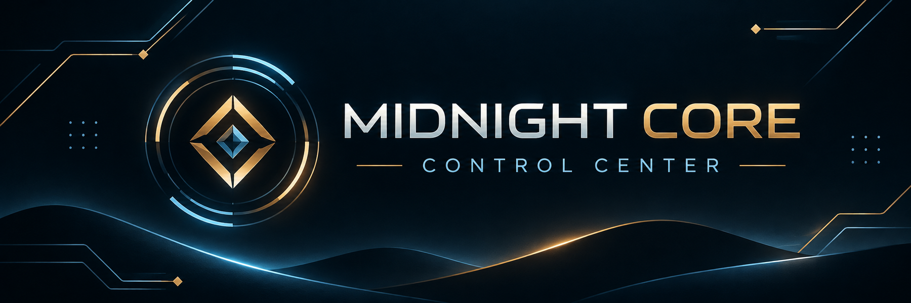
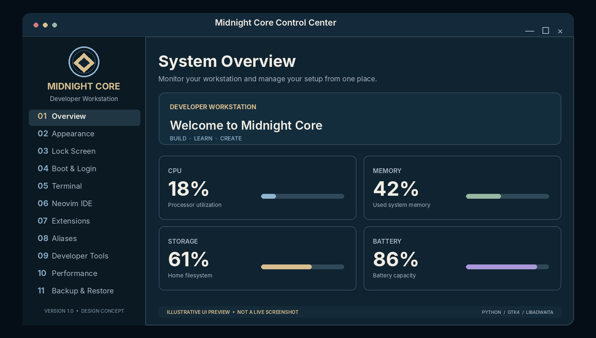
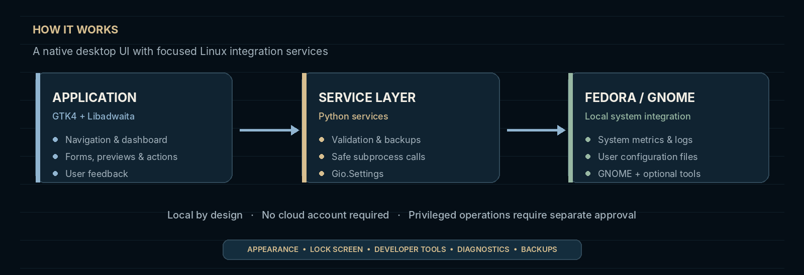

<div align="center">



# Midnight Core Control Center

**Your Fedora developer workstation. One control center.**

A native Linux desktop application that brings system monitoring, GNOME customization, development tools, and configuration management together in one place.

[](https://www.python.org/)
[](https://www.gtk.org/)
[](https://gnome.pages.gitlab.gnome.org/libadwaita/)
[](https://fedoraproject.org/)
[](LICENSE)

[Features](#features) · [Preview](#preview) · [Installation](#installation) · [Architecture](#architecture) · [Testing](#testing) · [License](#license)

</div>

---

## About the project

Midnight Core Control Center is a personal Linux customization and diagnostics project built with **Python, GTK4, Libadwaita, and PyGObject**.

It replaces scattered configuration commands with a cohesive graphical interface. Instead of opening multiple terminal windows to check performance, manage GNOME appearance, configure developer tools, or maintain backups, you can access these workflows from one desktop application.

The project was developed for a **Fedora GNOME workstation**, with a consistent midnight-blue, arctic-blue, and muted-gold design language.

> **Project philosophy:** Build. Learn. Create.

## Preview

<div align="center">
  
  <br />
  <sub>Illustrative interface concept — this is not a screenshot of the running application.</sub>
</div>

The application uses a sidebar to navigate between dedicated tools and settings pages. All pages are designed to fit into the same visual language.

> **Screenshots wanted:** For an authentic product showcase, capture the running Overview, Appearance, and Developer Tools pages on Fedora and replace the concept image. See [Adding real screenshots](#adding-real-screenshots).

## Features

| Module | Capabilities |
| :-- | :-- |
| **System Overview** | Live CPU, memory, disk, battery, uptime, kernel and hardware information. |
| **Appearance** | Manage GNOME color preference, installed GTK themes, icons, cursors, fonts and wallpapers; restore prior settings. |
| **Lock Screen** | Configure the companion Midnight Lock extension through its GSettings schema, including available animations and accent settings. |
| **Boot & Login** | Inspect Plymouth themes and GDM configuration; changing a Plymouth theme requires separate privileged authentication. |
| **Terminal** | Adjust supported Alacritty and Starship preferences while preserving existing configuration. |
| **Neovim IDE** | Manage supported editor preferences and access useful development commands. |
| **Extensions** | List GNOME extensions, check their state, enable/disable them and open their preferences. |
| **Aliases** | Browse existing Bash aliases and manage new aliases in a separate file. |
| **Developer Tools** | Read-only Git repository status, Docker container information, and installed development-tool versions. |
| **Performance** | Live resource monitoring, top processes, service checks, and available system error logs. |
| **Backup & Restore** | Create local configuration archives, verify their integrity and restore selected components. |

### A thoughtful approach to system changes

- **Native GNOME experience:** GTK4 and Libadwaita; no browser window or Electron runtime.
- **Local-first:** Configuration and backups stay on your machine.
- **Separation of concerns:** UI pages live in `midnight/pages/`; system operations live in `midnight/services/`.
- **Safer operations:** Read-only diagnostics by default, confirmation before impactful changes, and backups for supported settings workflows.
- **User-level application install:** The desktop launcher installs in your home directory; system-level changes, such as Plymouth updates, request separate authorization.

## Architecture

<div align="center">
  
</div>

The interface communicates with Python services that validate requests and access Linux or GNOME facilities. This keeps UI rendering separate from file editing, GSettings, diagnostics, and backup operations.

```text
midnight-core-control-center/
├── main.py                   # Application entry point
├── midnight/
│   ├── application.py        # Adw.Application and stylesheet
│   ├── window.py             # Main window and navigation
│   ├── pages/                # GTK pages
│   └── services/             # System access and application logic
├── assets/                   # Styles and application images
├── packaging/                # Per-user installation tools
├── scripts/                  # QA and source release helpers
├── tests/                    # Unit tests
├── docs/                     # Documentation and illustrations
├── .github/workflows/        # Automated checks
└── LICENSE
```

## Technology stack

| Layer | Technology |
| :-- | :-- |
| Language | Python 3 |
| Desktop UI | GTK4, Libadwaita, PyGObject |
| Desktop environment | GNOME (developed on Fedora) |
| Settings integration | GSettings / Gio |
| System information | Linux `/proc`, `/sys`, and selected CLI tools |
| Configuration | TOML, Lua, Bash and JSON, as appropriate |
| Quality checks | `unittest`, Python compilation checks, release preflight |
| Distribution | Per-user GNOME `.desktop` launcher and source archive |

## Installation

### Requirements

A **Fedora Linux desktop running GNOME** is the primary tested environment. Some modules integrate with optional tools, including GNOME Extensions, Plymouth, Alacritty, Starship, Neovim, Docker, and Git.

Install the core desktop dependencies:

```bash
sudo dnf install git python3-gobject gtk4 libadwaita
```

> The application uses Fedora's **system Python** so PyGObject can access the GTK/Libadwaita libraries installed by the package manager.

### Option A — Run from source

```bash
git clone https://github.com/ahm5edt456/midnight-core-control-center.git
cd midnight-core-control-center
/usr/bin/python3 main.py
```

### Option B — Install in the GNOME app grid

From the cloned repository:

```bash
bash packaging/install.sh "$PWD"
```

Then launch it from GNOME's application grid by searching for **Midnight Core Control Center**, or run:

```bash
~/.local/bin/midnight-control-center
# Alternative:
gtk-launch io.midnightcore.ControlCenter
```

**The installer does not require `sudo`.** It copies a runtime snapshot under `~/.local/share/midnight-core-control-center/` and creates a user-level launcher and icon. It does not automatically update when you edit the Git repository.

### Update the installed application

After editing the source, close the app and rerun:

```bash
bash packaging/install.sh "$PWD"
```

### Uninstall the desktop application

```bash
bash packaging/uninstall.sh
```

The project directory, user configuration, and backups are intended to remain intact. See [`packaging/README.md`](packaging/README.md) for details.

## Testing

Check Python syntax:

```bash
/usr/bin/python3 -m compileall -q main.py midnight
```

Run the automated release preflight:

```bash
python3 scripts/release_suite.py check --project .
cat dist/QA_REPORT.md
```

Build a source release archive after checks pass:

```bash
python3 scripts/release_suite.py build --project .
```

GUI behavior and system integration should also be checked manually on a Fedora GNOME session. A passing automated check alone does not guarantee that every optional module works on all hardware.

## Privacy and safety

- Most monitoring and diagnostic workflows are read-only.
- Avoid sharing backup ZIP archives, which may contain personal configuration data.
- Some tools depend on installed GNOME extensions or utilities and will report unavailable data when those dependencies are missing.
- Plymouth changes may require administrator approval and can affect the boot splash; use that feature with care.
- The project is designed for GNOME/Fedora workflows and is **not** a replacement for the operating system's core settings app.

## Adding real screenshots

The included interface illustration is intentionally labeled as a concept. To showcase the real application:

1. Open the installed app on Fedora and capture the **Overview**, **Appearance**, and **Developer Tools** pages.
2. Save the images as `docs/images/overview.png`, `docs/images/appearance.png`, and `docs/images/developer-tools.png`.
3. Replace the concept image in the Preview section, or add the following Markdown:

```markdown
| Overview | Appearance |
| :--: | :--: |
|  |  |


```

Do not include private usernames, internal paths, tokens, or sensitive logs in screenshots.

## Roadmap

- [x] Native control center UI and navigation
- [x] GNOME appearance and lock screen integration
- [x] Developer environment panels
- [x] System monitoring and diagnostics
- [x] Backup and restore workflows
- [x] Local desktop application packaging
- [x] Automated release checks
- [ ] Publish real application screenshots
- [ ] Broader distro compatibility testing
- [ ] Optional RPM or Flatpak packaging

## Contributing

Ideas, bug reports, and pull requests are welcome. If you report an issue, include your Fedora and GNOME versions, the affected module, steps to reproduce, and relevant logs **with sensitive information removed**.

## License

This project is licensed under the [MIT License](LICENSE).

---

<div align="center">

**MIDNIGHT CORE**

*Build · Learn · Create*

Made for a more focused Linux developer workflow.

</div>
